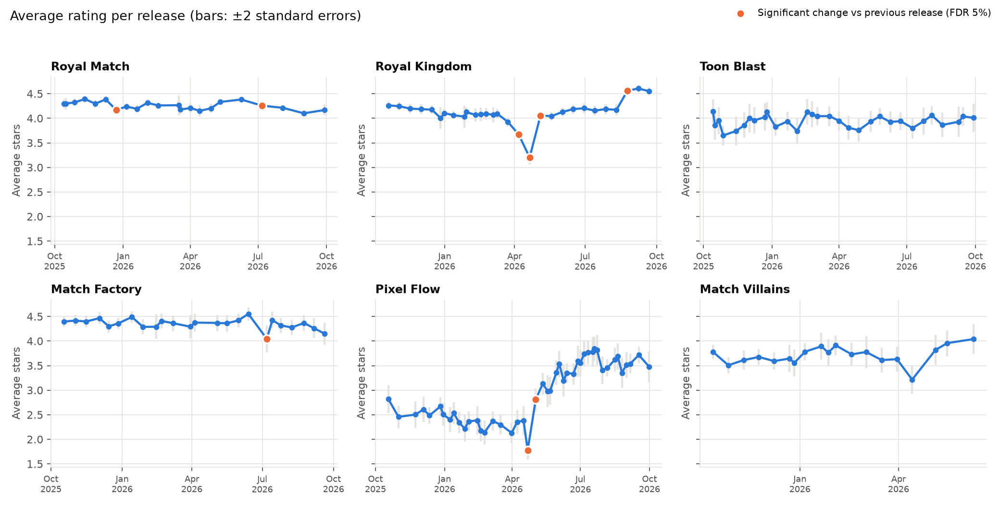
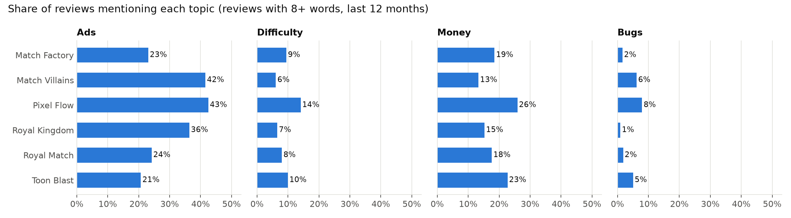
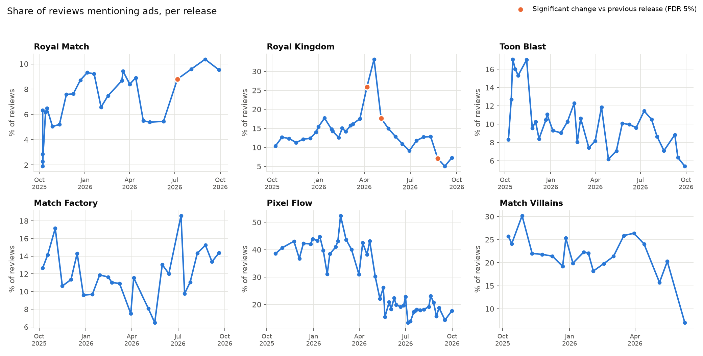

# Game Update Radar

**How do players react to updates in top mobile puzzle games, and which kinds of updates move their sentiment?**

Live-ops games ship a new version every 2–4 weeks. Each release changes levels, events, mechanics, and sometimes ads or prices, and studios need to know quickly how players received it. This project builds that view from public data: it collects 12 months of Google Play reviews for globally popular puzzle games from Turkish studios, links every review to the **game version the player actually had installed**, and measures how ratings and complaints shift from release to release.

Games covered: **Royal Match** and **Royal Kingdom** (Dream Games), **Toon Blast** and **Match Factory** (Peak), **Pixel Flow** (Loom Games), **Match Villains** (Good Job Games).

> Status: first analysis done (baseline). Findings below are preliminary; each one is being checked by reading the underlying reviews.

## Why version-level, not date-level

Most review dashboards group reviews by date. But many players don't update right away: in our data, Royal Match reviews come from 45 different versions within a single month. Grouping by date mixes reactions to the new release with reactions from players still on old builds. Google Play records the installed version with each review (`reviewCreatedVersion`), so this project groups by version instead. The first time a version appears in reviews is used as its release date; for Royal Match this matches the App Store release date exactly (version 38911, Sep 28).

## Early findings



- **Royal Kingdom, April–May 2026:** ad complaints rose to ~26% of reviews in version 28796 (+8 percentage points), then fell by 15 points two releases later. It looks like an ad change that drew backlash and was reverted. *(Being verified by reading the reviews.)*
- **Royal Match 37281 (July 2026):** two independent signals moved together: average rating fell 0.13 stars and ad mentions rose from 5.5% to 8.8%. The release notes don't mention ads, so the change may have shipped server-side.
- **Pixel Flow 0.24.3 (May 2026):** bug complaints dropped from ~21% to 6% of reviews, a bug-fix release that clearly worked.
- **Release cadence:** Royal Match moved from a 2-week to a ~4-week release cycle around spring 2026.
- **Ads are the #1 complaint topic in every game**, but at very different levels (see below).





## A hypothesis that didn't hold up

Reviews **without** a version number are much more negative (Royal Match: 2.94 vs 4.13 stars). I hypothesized they come from players who had already uninstalled, which would make them a public signal of churn.

To test it, I checked whether they mention quitting ("uninstalled", "deleted", "quit") more often. They do (raw gap 1–4 points), but angrier reviews mention quitting more in general. **Compared at the same star rating, the gap disappears** (−0.1 to +1.6 points, |z| ≤ 2). So the data does not support "no version = churned player". The churn layer now tracks *stated* quitting intent directly instead.

## Method

1. **Collect** (`02_collect.py`): newest-first pagination back 12 months, English reviews from the US store. Incremental after the first run (only new reviews), checkpointed every 10 pages, de-duplicated by review ID. Usernames are never stored.
2. **Analyze** (`03_analyze.py`):
   - Data checks: duplicates, gaps, empty text.
   - Release table: average stars per version (≥100 reviews), compared with the previous release using standard errors.
   - Topic baseline: transparent keyword lists for ads, difficulty, lives, money, bugs, progress loss, content, events. A model comes later only if it beats this baseline on a hand-labeled test set.
   - **Multiple comparisons:** 1,000+ version × topic tests are run at once, so p-values are adjusted with Benjamini–Hochberg (FDR 5%). Without this, ~50 "findings" would appear by chance alone.
3. **Figures** (`04_figures.py`).

Design decisions and their reasons are logged in [NOTES.md](NOTES.md).

## Limitations

- Only players who write reviews are heard, and they are more negative than average (our samples average 3.5–4.4 stars vs 4.4–4.7 in the stores).
- English reviews only; non-English markets aren't covered.
- Content shipped server-side (events, level drops, ad settings) without an app update is invisible to version-level analysis.
- Results show association, not cause: players who update early may differ from those who don't.
- Keyword topics miss paraphrases and can be fooled by negation. They cover ~20% of reviews (most reviews are 3–5 words, like "great game").

## Roadmap

- [ ] Verify each finding by reading samples of the underlying reviews
- [ ] Hand-label ~500 reviews; measure keyword precision/recall; compare with pretrained models
- [ ] Classify release notes by update type (new mechanic, event, area) and link types to reactions
- [ ] Daily GitHub Actions run that refreshes a report page for every new release

## Run it

```bash
python3 -m venv .venv && source .venv/bin/activate
pip install -r requirements.txt
python 02_collect.py     # ~30 min the first time, seconds afterwards
python 03_analyze.py
python 04_figures.py
```

Raw reviews are not included in this repository (privacy and platform terms); only aggregated results in `results/` are published.

---
Built by [Fethiye Ebrar Güçlü](https://ebrarguclu.github.io) · data collected October 2026
